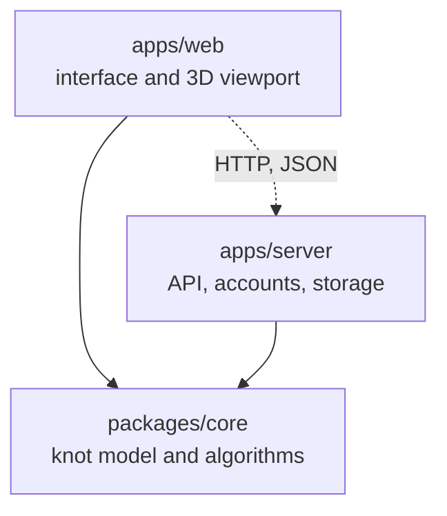
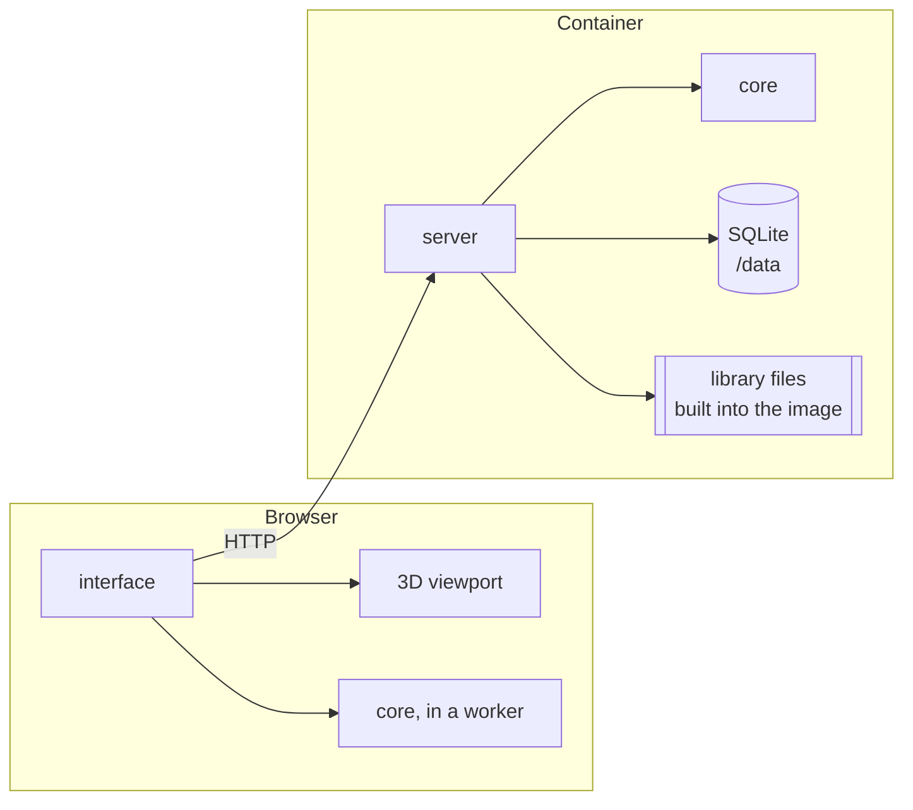

# Architecture

This document describes the intended structure and says, at the end, how much of it exists. The decisions behind it are in [docs/adr](docs/adr/README.md).

## Principles

1. **The model comes first.** A knot is a document with a topology, a geometry and a construction (ADR 0001). Everything else reads or writes that document.
2. **The core knows nothing about the screen.** It has no dependency on a renderer, a UI framework or the DOM (ADR 0007).
3. **One implementation of the mathematics**, used by the browser and the server alike (ADR 0008).
4. **One container, one process, one data directory.** No services to orchestrate.
5. **Nothing is claimed that was not checked.** Comparisons return a grade with evidence (ADR 0006); content claims carry a source.

## Packages

| Package | Responsibility | May depend on |
| --- | --- | --- |
| `packages/core` | Document types and validation; diagrams (planarity, faces, PD codes, moves); extracting a diagram from geometry; invariants; graded comparison; geometric checks | Nothing at run time |
| `apps/web` | The interface: library, viewer, tutorials, laboratory. The 3D viewport. Translations. | `core`, React, Three.js |
| `apps/server` | The HTTP API, sessions, the database, serving the built interface and the library | `core`, Hono |

The direction of dependencies is enforced by lint rules: `core` may import neither of the applications, nor React, nor Three.js.

## At run time

- The browser runs the core itself. Checking a tutorial step while the user drags a rope cannot wait for a network round trip, and the application should work offline.
- Heavy computations run in a worker, so the interface stays responsive. The core's plain-data interface makes that possible.
- The server validates what it stores with the same core, serves the library, and holds accounts and user-created documents.

## Data

| Data | Where | Format |
| --- | --- | --- |
| Library content | Files in the repository, packaged into the image (ADR 0009) | Knot documents and library entries as JSON; texts per language |
| User-created documents, accounts, sessions | SQLite in the data directory | Knot documents stored as JSON |
| Interface text | Translation files in `apps/web` | i18next resources, English and Spanish |
| Preferences such as language | The browser | Local storage |

The knot document format is specified in [docs/spec/knot-document-model.md](docs/spec/knot-document-model.md). Identifiers, codes and mathematical notation are never translated.

## The 3D viewport

The viewport is an imperative module around Three.js, wrapped by a single React component. It receives geometry frames (centerlines with a radius) and display options, and reports pointer interactions in terms of the rope: which component, at which material coordinate.

It owns the tube geometry (rotation-minimising frames, updated in place), picking against centerlines, the camera, and the treatment that makes over and under legible. It does not compute topology; it asks the core.

A 2D diagram view is drawn from the topology layer, not from the 3D picture. It is both the unambiguous statement of over and under and the accessible alternative to the canvas.

## Tests

| Layer | Tool | What it covers |
| --- | --- | --- |
| Core | Vitest, fast-check | Unit tests, property tests, and agreement with the oracle fixtures |
| Interface | Vitest with Testing Library | Components and state |
| End to end | Playwright with axe | Real user flows in a browser, with accessibility checks |
| Container | CI job | The image builds, starts, answers `/healthz`, runs as the right user |

The strategy for the mathematics is in [docs/spec/validation-strategy.md](docs/spec/validation-strategy.md).

## Deployment

One image built from this repository. Configuration by environment variables. Data under `/data`, so a backup is a copy of that directory. The process runs as a non-root user and honours `PUID` and `PGID`. The application is meant to run on a private network; it is not designed to be exposed to the internet.

## What exists today

As of 2026-11-24. This section is updated with every pull request that changes it.

| Part | State |
| --- | --- |
| `packages/core` | Diagrams: structure checks (rules T1, T2), the surface a code is drawn on (T3), the faces of rope ends (T5), PD codes, mirror, closure and joining of components. The Kauffman bracket and Jones polynomial. Closed braids, torus braid words, torus knots and links as curves. Extraction of a diagram from polylines in space. Not yet: document schema, moves, graded comparison, geometric checks, other invariants. |
| `apps/server` | A health check, a diagram check that uses the core, and serving the built interface. Not yet: accounts, storage, the library. |
| `apps/web` | The shell in English and Spanish, and one page: a torus knot laboratory with a 3D view and the values the core computes. The viewport draws one or several ropes in one of six rope styles and orbits: laid rope as its three strands, braided rope with its woven sheath, or a smooth line; natural fibre has loose fibres; the ropes are lit by a room and a key light and shade each other where one passes over another. The surfaces of the ropes are computed, in a worker. Automated browsers get a plain drawing unless they ask for the full one. Not yet: a worker for the core (it runs on the main thread), the 2D diagram view, picking, the library, tutorials. |
| Container | One image, non-root, `PUID`/`PGID`, `/healthz`. The data directory exists and nothing is stored in it yet. |
| CI | Two stages on GitHub-hosted runners: commit messages, secrets, audit, types, lint, tests, build; then end-to-end tests and the image. |

The server and the core run from their TypeScript source: Node removes the types as it loads them. Only the interface has a build step.
