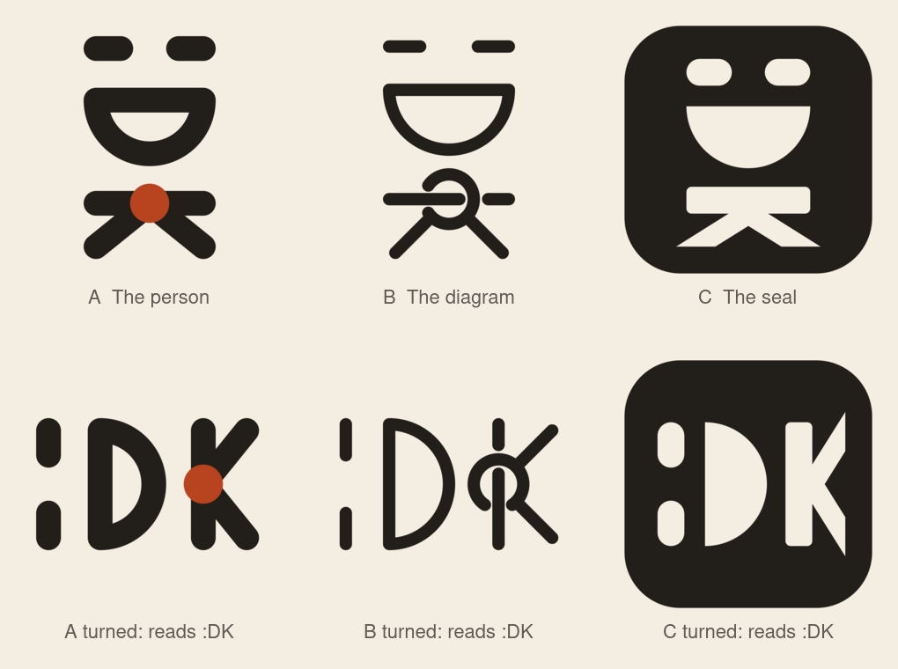
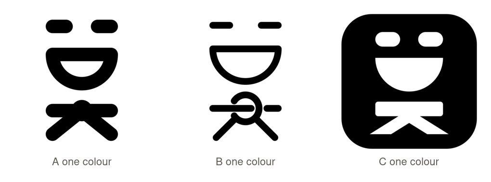
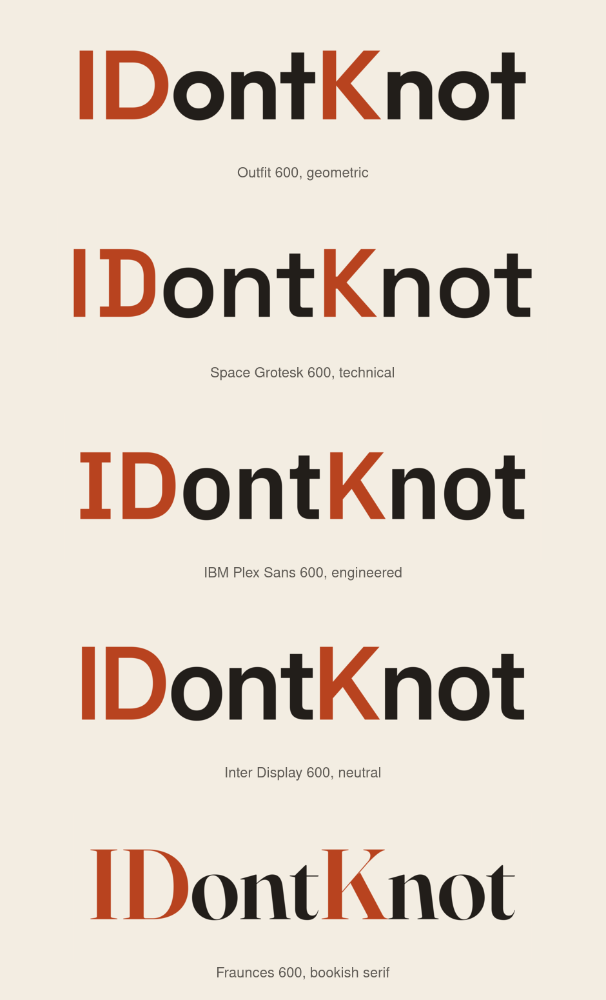
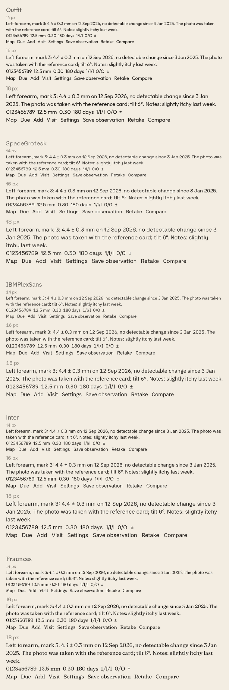

# Brand identity

## Round 1: three directions for the mark

Status: proposals. Nothing here is decided. This round asks for one decision: which direction to develop.

### Brief

- **It must communicate:** hands, knot, delight.
- **It must never suggest:** a children's game (the product has no gamification); danger or alarm; one discipline above the others (no anchor, no carabiner); anything sexual.
- **Where it lives:** a 16 px favicon, an app icon, a store card, the README header, a dark interface header. Every candidate has to survive the smallest of these.
- **Fixed decisions:** the product is written IDontKnot. The mark integrates the initials IDK as `:DK`, with the I split into two segments.
- **The Product Owner's words:** "me gustaría que el logo integrase las iniciales IDK (:DK, (dividiendo la I en dos segmentos) en vertical estilo emoticono parece una persona feliz con las manos juntas como si estuviera tejiendo un nudo)".
- **Declined in earlier rounds:** none. This is the first round.

### The idea

All three directions share one skeleton, drawn on a 256-unit grid:

| Letter | Shape | Upright, it is |
| --- | --- | --- |
| I, split in two | two short segments | the eyes |
| D | a half disc, flat side up | the smile |
| K | a bar and two diagonals meeting at its middle | a rope, and two arms with the hands together on it |

Upright it is a figure. Turned a quarter turn anticlockwise it reads `:DK`. The directions differ in character, not in idea, because the idea was given.

| | Direction | What it is | Strength | Weakness |
| --- | --- | --- | --- | --- |
| A | The person | Strokes as thick as a rope, round ends. One coloured bead where the hands meet: the knot. | The friendliest. Reads at 16 px. Symmetric. | The bar, arms and bead can also be read as a bow tie. A bow tie is a knot, so the reading is not wrong, but it is not the one asked for. |
| B | The diagram | A thin line. At the joint of the K the rope passes through a ring, over on one side and under on the other, drawn with the gaps a knot diagram uses. | The only one that speaks the language of knot diagrams. | Disappears below 32 px, so it needs A's form as a small-size glyph. Deliberately not symmetric at the ring. |
| C | The seal | Solid shapes cut out of a rounded block. No line work. | The strongest at small sizes and as an app icon. Symmetric. | The least hand-made. Reads as a face more than as someone tying. |

### On dark, and in one colour

### At real sizes

Each mark at 16, 24, 32 and 48 px, at real size and enlarged eight times.

A keeps eyes, smile, bead and arms at 16 px. B loses its line at 16 and 24 px. C holds its face at every size; the K below the smile blurs at 16 px.

### Wordmark

Five typefaces, all under the SIL Open Font License, set with real shaping and normalised to one cap height. The three initials take the accent colour.

| Typeface | Character | Note |
| --- | --- | --- |
| Outfit | Geometric, open, friendly | Round forms echo the mark's round ends |
| Space Grotesk | Technical, slightly eccentric | Its capital I has slab serifs and collided with the D; the pair was opened by 45 thousandths of an em |
| IBM Plex Sans | Engineered | The serifed capital I cannot be mistaken for a lowercase l |
| Inter Display | Neutral | The safest, and the least distinctive |
| Fraunces | Bookish serif | The encyclopedia side of the product |

At text sizes, because the wordmark face usually becomes the interface face:

Font files are not in the repository yet. They will be added, with their licences, for the face that is chosen.

### Colour

Three base palettes, each with a light and a dark paper. Discipline themes are a later round and would sit on top of the chosen base.

| Palette | Role | Light | Dark | Contrast on its paper, light / dark |
| --- | --- | --- | --- | --- |
| 1 Hemp and tar | paper | `#F3EDE2` | `#1A1714` | |
| | ink | `#221E1A` | `#EFE7DA` | 14.2 / 14.5 |
| | accent | `#B8431F` | `#EC7A50` | 4.7 / 6.4 |
| 2 Ink and chart | paper | `#F4F5F2` | `#0F1522` | |
| | ink | `#121A2B` | `#E8ECF4` | 15.9 / 15.4 |
| | accent | `#2450C8` | `#7C9DFF` | 6.3 / 7.1 |
| 3 Slate and brass | paper | `#F1F0EA` | `#151917` | |
| | ink | `#1D2320` | `#ECEAE2` | 14.0 / 14.7 |
| | accent | `#7A5C0A` | `#DDB85C` | 5.5 / 9.4 |

Every pair passes WCAG AA for body text (4.5:1).

### Mark and name together

Examples only, to show scale and feel. The pairing of mark and typeface is open.

### What was checked

- Drawn on the 256 grid, one stroke weight per mark, consistent ends and joins.
- A and C are exactly symmetric about the vertical axis (0 differing pixels when mirrored). B is not, by design: over on one side, under on the other.
- Rendered at 16, 24, 32 and 48 px.
- Dark variants exist; every accent keeps more than 3:1 on its dark paper.
- Wordmarks shaped with HarfBuzz; the pairs around the capitals were inspected and one was adjusted.
- Text contrast computed for every palette.

### Not in this round

Final lockups with clear space and minimum sizes; favicon and app-icon files; a small-size glyph for B; discipline themes; iconography; motion; font files.

### Files

- `sources/make_marks.py` generates every mark and palette card. Changing a parameter and rerunning it is how the next round is made.
- `svg/` holds the marks (light, dark, one colour, turned, without background), the wordmarks, the example lockups and the palette cards.
- `boards/` holds the rendered boards shown above.

### Decision asked

Which direction is developed in round 2?

- **A, the person** (suggested default)
- B, the diagram
- C, the seal
- A combination, for example A as the mark with B's ring as a detail at large sizes
