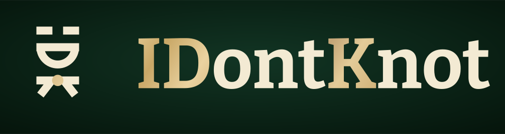
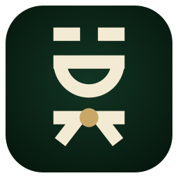

# Brand identity

## The mark

The mark is the initials IDK written as `:DK`, with the I split into two segments. The idea is the Product Owner's.

| Letter | Shape | Upright, it is |
| --- | --- | --- |
| I, split in two | two short bars | the eyes |
| D | a half disc, flat side up | the smile |
| K | a bar and two diagonals | a rope, and an arm reaching it on each side of a knot |

Upright it is a happy figure tying a knot. Turned a quarter turn anticlockwise it reads `:DK`.

It is drawn on a 256-unit grid with one stroke weight and flat ends, and is exactly symmetric about its vertical axis. It keeps eyes, smile, knot and arms at 16 px.

## Decisions

All taken by the Product Owner, 2026-11-23 and 2026-11-24.

| Topic | Decision |
| --- | --- |
| Name | Written IDontKnot |
| Concept | The initials as `:DK`, read upright as a person with the hands together on a knot |
| Drawing | A figure in rope-weight strokes, each hand reaching the rope beside the knot, with flat ends to sit beside the typeface |
| Typeface | Bitter, a slab serif. Chosen because serifs give each letter more stroke junctions, which suits the subject: the I becomes the section of an I-beam |
| Colour | A near-black forest green, ivory, and a satin gold, taken from a reference image supplied by the Product Owner |
| Treatment | Ivory for the figure and the letters. Gold for the knot and for the initials I, D and K. A soft sheen on the gold at large sizes; flat gold at small sizes and in the interface |

## Colour

| Token | Value | Use | Contrast on green |
| --- | --- | --- | --- |
| green edge | `#05140B` | Darkest surface; outer edge of the vignette | |
| green | `#0B2315` | The brand surface | |
| green glow | `#123524` | Centre of the vignette; raised surfaces | |
| ivory | `#F3EAD3` | Ink on green | 13.9 |
| gold | `#C9A867` | The accent, flat | 7.3 |
| satin gold | `#C9A867` `#EAD2A0` `#D2B47C` `#E3CB98` `#C4A577` | The accent as a soft sheen | Large graphics only |

Ivory and flat gold both pass WCAG AA for body text on the green.

## Rules of use

- The knot and the three initials are the only gold elements.
- Use the satin versions for large display: a header, a splash screen, a store card. Use the flat versions for the favicon, the interface and anything below about 64 px.
- Do not put the mark on a light surface yet: a light variant has not been designed.
- Do not redraw or re-space the wordmark. Its letters are outlines with the typeface's own kerning.

## Files

| File | Contents |
| --- | --- |
| `svg/mark.svg`, `svg/mark-satin.svg` | The mark for green surfaces, flat and with sheen, no background |
| `svg/mark-one-colour.svg` | The mark in a single colour |
| `svg/icon.svg`, `svg/icon-satin.svg` | The app icon: the mark on a rounded green block |
| `svg/wordmark.svg`, `svg/wordmark-satin.svg` | The name, no background |
| `svg/lockup.svg`, `svg/lockup-satin.svg` | Mark and name together on green |
| `sources/make_brand.py` | Generates the marks and icons. Change a parameter and rerun it; do not edit the SVG files by hand. |

The wordmark is Bitter at weight 700, shaped with HarfBuzz, tracked by −0.005 em, and converted to outlines. Bitter is under the SIL Open Font License. Its font files will be added, with the licence, when the interface is built.

## Considered and declined

Kept as a note so that these are not proposed again. The explorations themselves were reviewed locally and are not in the repository.

- **Other drawings of the same idea:** a thin-line version with the rope threaded through a ring, like a knot diagram (vanished below 32 px); a solid seal; versions built from the typeface's own letters (read as letters lying down, and blurred at small sizes); round ends; slab serifs on the figure.
- **Other colours:** a warm hemp and terracotta; a navy and ultramarine; a slate and brass; a jewel teal and its greener steps; navy blue with red.
- **Other typefaces:** plain sans faces, which have a third of the stroke junctions; other slab serifs, which differ little from Bitter in that respect.

## Still to do

A variant for light surfaces; favicon and app-icon files in the sizes each platform needs; clear-space and minimum-size rules; themes by discipline; iconography; motion.
