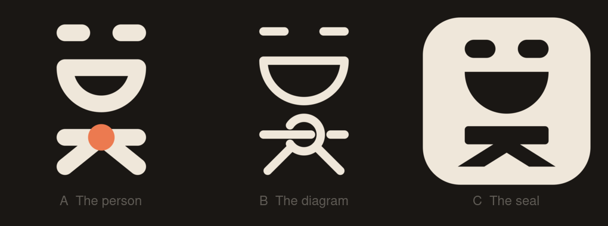
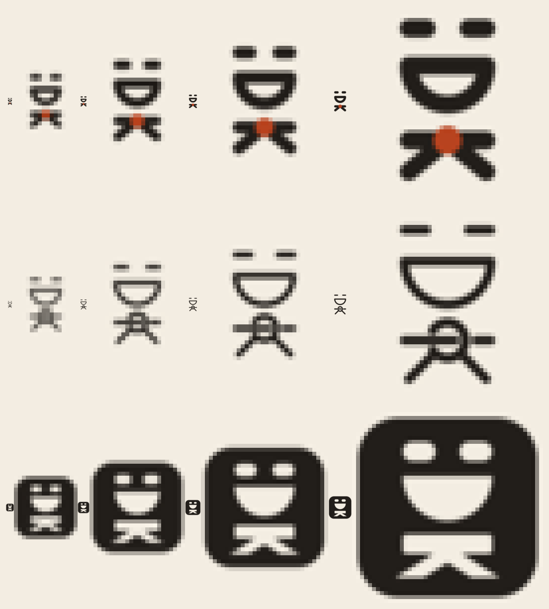
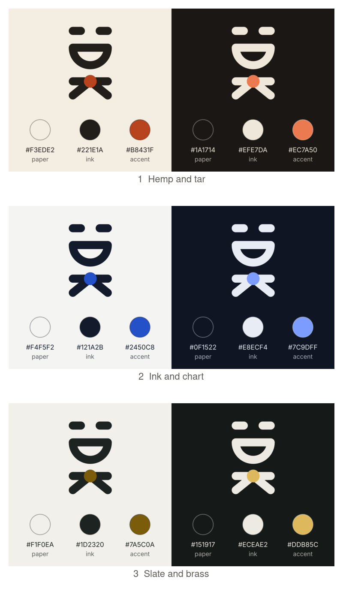
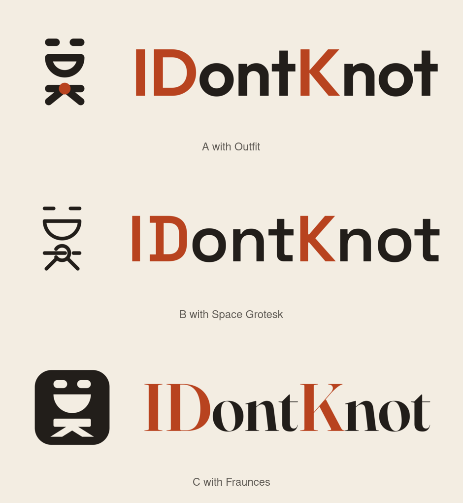
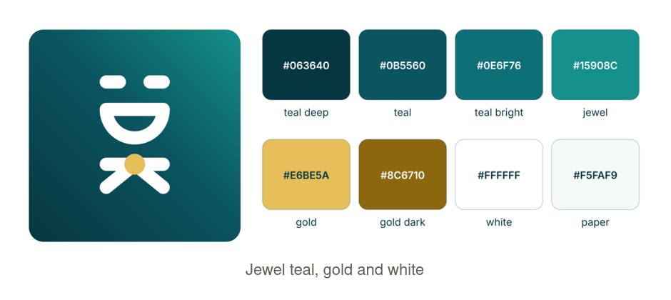
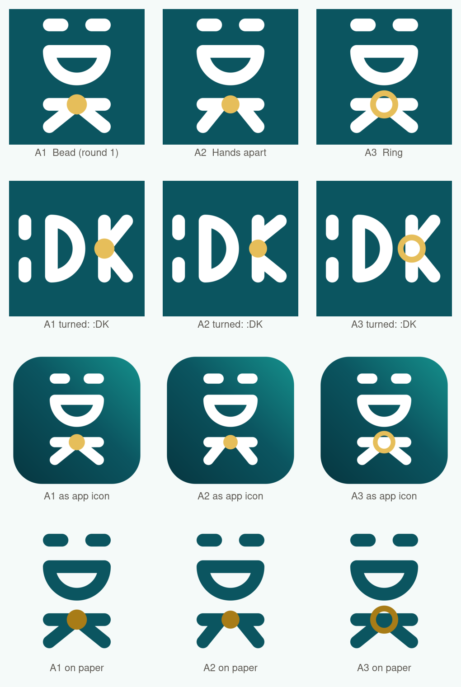
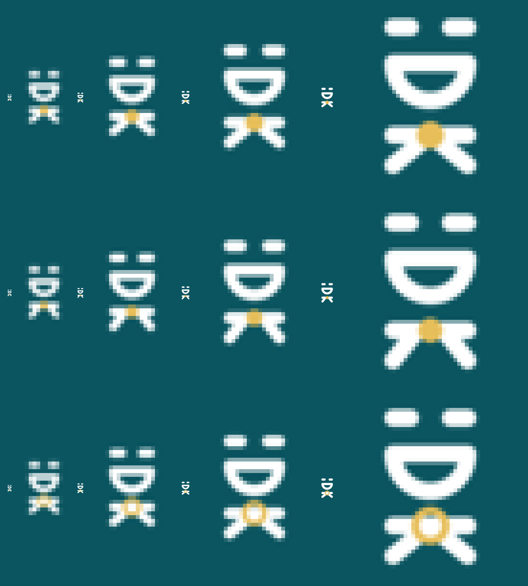
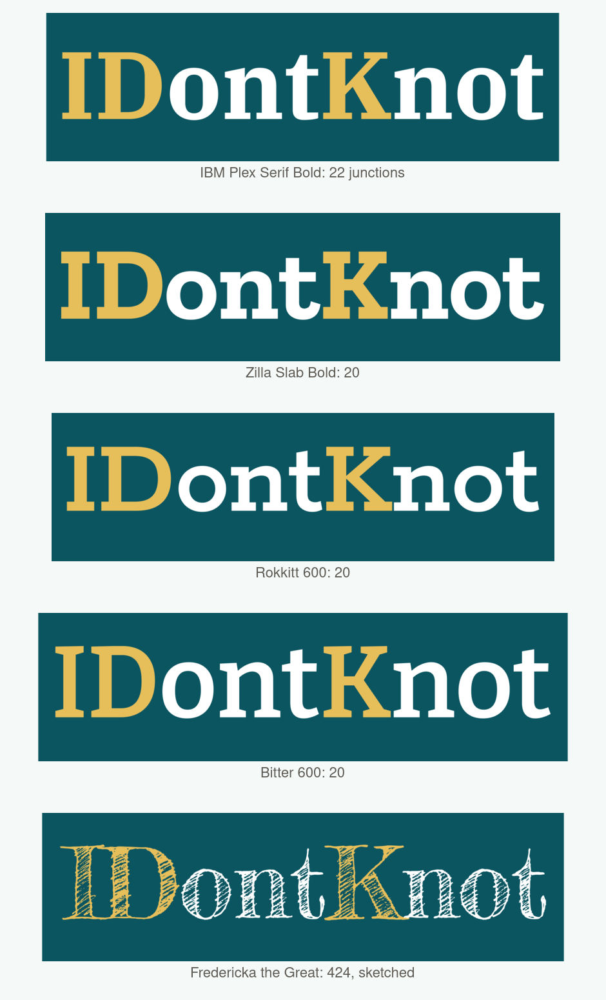
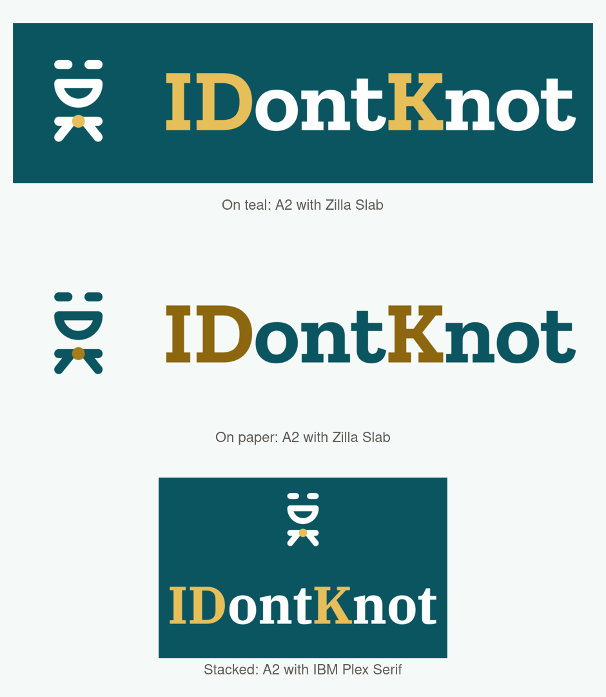

# Brand identity

Two rounds so far. Round 1 chose the direction of the mark; its outcome is recorded at the end of its section. Round 2 is open.

## Round 1: three directions for the mark

Status: closed. Direction A was chosen; the palettes and typefaces shown here were declined.

### Brief

- **It must communicate:** hands, knot, delight.
- **It must never suggest:** a children's game (the product has no gamification); danger or alarm; one discipline above the others (no anchor, no carabiner); anything sexual.
- **Where it lives:** a 16 px favicon, an app icon, a store card, the README header, a dark interface header. Every candidate has to survive the smallest of these.
- **Fixed decisions:** the product is written IDontKnot. The mark integrates the initials IDK as `:DK`, with the I split into two segments.
- **The Product Owner's words:** "me gustaría que el logo integrase las iniciales IDK (:DK, (dividiendo la I en dos segmentos) en vertical estilo emoticono parece una persona feliz con las manos juntas como si estuviera tejiendo un nudo)".
- **Declined in earlier rounds:** none. This is the first round.

### The idea

All three directions share one skeleton, drawn on a 256-unit grid:

| Letter | Shape | Upright, it is |
| --- | --- | --- |
| I, split in two | two short segments | the eyes |
| D | a half disc, flat side up | the smile |
| K | a bar and two diagonals meeting at its middle | a rope, and two arms with the hands together on it |

Upright it is a figure. Turned a quarter turn anticlockwise it reads `:DK`. The directions differ in character, not in idea, because the idea was given.

| | Direction | What it is | Strength | Weakness |
| --- | --- | --- | --- | --- |
| A | The person | Strokes as thick as a rope, round ends. One coloured bead where the hands meet: the knot. | The friendliest. Reads at 16 px. Symmetric. | The bar, arms and bead can also be read as a bow tie. A bow tie is a knot, so the reading is not wrong, but it is not the one asked for. |
| B | The diagram | A thin line. At the joint of the K the rope passes through a ring, over on one side and under on the other, drawn with the gaps a knot diagram uses. | The only one that speaks the language of knot diagrams. | Disappears below 32 px, so it needs A's form as a small-size glyph. Deliberately not symmetric at the ring. |
| C | The seal | Solid shapes cut out of a rounded block. No line work. | The strongest at small sizes and as an app icon. Symmetric. | The least hand-made. Reads as a face more than as someone tying. |

### On dark, and in one colour

### At real sizes

Each mark at 16, 24, 32 and 48 px, at real size and enlarged eight times.

A keeps eyes, smile, bead and arms at 16 px. B loses its line at 16 and 24 px. C holds its face at every size; the K below the smile blurs at 16 px.

### Wordmark

Five typefaces, all under the SIL Open Font License, set with real shaping and normalised to one cap height. The three initials take the accent colour.

| Typeface | Character | Note |
| --- | --- | --- |
| Outfit | Geometric, open, friendly | Round forms echo the mark's round ends |
| Space Grotesk | Technical, slightly eccentric | Its capital I has slab serifs and collided with the D; the pair was opened by 45 thousandths of an em |
| IBM Plex Sans | Engineered | The serifed capital I cannot be mistaken for a lowercase l |
| Inter Display | Neutral | The safest, and the least distinctive |
| Fraunces | Bookish serif | The encyclopedia side of the product |

At text sizes, because the wordmark face usually becomes the interface face:

Font files are not in the repository yet. They will be added, with their licences, for the face that is chosen.

### Colour

Three base palettes, each with a light and a dark paper. Discipline themes are a later round and would sit on top of the chosen base.

| Palette | Role | Light | Dark | Contrast on its paper, light / dark |
| --- | --- | --- | --- | --- |
| 1 Hemp and tar | paper | `#F3EDE2` | `#1A1714` | |
| | ink | `#221E1A` | `#EFE7DA` | 14.2 / 14.5 |
| | accent | `#B8431F` | `#EC7A50` | 4.7 / 6.4 |
| 2 Ink and chart | paper | `#F4F5F2` | `#0F1522` | |
| | ink | `#121A2B` | `#E8ECF4` | 15.9 / 15.4 |
| | accent | `#2450C8` | `#7C9DFF` | 6.3 / 7.1 |
| 3 Slate and brass | paper | `#F1F0EA` | `#151917` | |
| | ink | `#1D2320` | `#ECEAE2` | 14.0 / 14.7 |
| | accent | `#7A5C0A` | `#DDB85C` | 5.5 / 9.4 |

Every pair passes WCAG AA for body text (4.5:1).

### Mark and name together

Examples only, to show scale and feel. The pairing of mark and typeface is open.

### What was checked

- Drawn on the 256 grid, one stroke weight per mark, consistent ends and joins.
- A and C are exactly symmetric about the vertical axis (0 differing pixels when mirrored). B is not, by design: over on one side, under on the other.
- Rendered at 16, 24, 32 and 48 px.
- Dark variants exist; every accent keeps more than 3:1 on its dark paper.
- Wordmarks shaped with HarfBuzz; the pairs around the capitals were inspected and one was adjusted.
- Text contrast computed for every palette.

### Not in this round

Final lockups with clear space and minimum sizes; favicon and app-icon files; a small-size glyph for B; discipline themes; iconography; motion; font files.

### Files

- `sources/make_marks.py` generates every mark and palette card. Changing a parameter and rerunning it is how the next round is made.
- `svg/` holds the marks (light, dark, one colour, turned, without background), the wordmarks, the example lockups and the palette cards.
- `boards/` holds the rendered boards shown above.

### Decision asked

Which direction is developed in round 2?

- **A, the person** (suggested default)
- B, the diagram
- C, the seal
- A combination, for example A as the mark with B's ring as a detail at large sizes

### Outcome of round 1 (Product Owner, 2026-11-23)

- **Direction:** A, the person. B and C are declined.
- **Colour:** none of the three palettes. The brand should lean towards a jewel teal (blue-green) gradient, with a gold and a white. The three palettes above are declined.
- **Typeface:** none of the five as shown. The wish is a face in which every letter has as many crossings as possible, to speak of knots: the I should not be a stick but the cross-section of an I-beam. The plain sans faces (Outfit, Space Grotesk, Inter Display) are declined for the wordmark.

## Round 2: direction A in jewel teal and gold

Status: proposals. This round changes three things, each in answer to round 1: the colour, the joint where the hands meet, and the typeface.

### Colour

The Product Owner pointed to a reference image by link. The link refused automated access, so the palette below was built from its description (a teal, jewel-toned gradient, with gold and white) and has not been compared with the image itself.

| Token | Value | Use | Contrast |
| --- | --- | --- | --- |
| teal deep | `#063640` | Darkest surface, start of the gradient; text on light paper | white on it 13.1 |
| teal | `#0B5560` | The brand surface | white on it 8.5; gold on it 4.8 |
| teal bright | `#0E6F76` | Raised surfaces | white on it 5.9; gold on it 3.3 (large text and graphics only) |
| jewel | `#15908C` | End of the gradient, decoration | white on it 3.9 (large text and graphics only) |
| gold | `#E6BE5A` | The accent on teal: the knot, the initials | 7.4 on teal deep |
| gold dark | `#8C6710` | The accent as text on light paper | 4.9 on paper |
| white | `#FFFFFF` | Ink on teal | |
| paper | `#F5FAF9` | Light surface | teal on it 8.0 |

The gradient runs from teal deep at the lower left to jewel at the upper right. Body text never sits on the bright end of it.

### The joint

Round 1 noted that the bar, the arms and the bead can be read as a bow tie. Three treatments of that one spot, everything else unchanged:

| | Variation | What changed | Effect |
| --- | --- | --- | --- |
| A1 | Bead | Nothing: round 1, recoloured | The reference. The bow-tie reading remains. |
| A2 | Hands apart | Each arm reaches the rope beside the knot, not at one point | Reads as two hands holding a rope with a knot between them. Turned, the K is still a K. |
| A3 | Ring | The bead becomes a gold ring around the joint | Reads as an eye or a ring more than as a knot. The ring loses its hole below 32 px. |

All three keep eyes, smile, knot and arms at 16 px on teal.

### Typeface: counting junctions

To make "as many crossings as possible" something that can be compared, each letter of the name was rendered large, thinned to its skeleton, and the points where three or more strokes meet were counted. The script is `sources/count_junctions.py`. It is a proxy: it depends on rendering size and on how short a spur is ignored.

| Typeface | Total in "IDontKnot" | I | D | o | n | t | K |
| --- | --- | --- | --- | --- | --- | --- | --- |
| IBM Plex Serif | 22 | 2 | 2 | 0 | 4 | 2 | 6 |
| Fraunces | 22 | 2 | 2 | 0 | 4 | 2 | 6 |
| Zilla Slab | 20 | 2 | 2 | 0 | 3 | 2 | 6 |
| Rokkitt | 20 | 2 | 2 | 0 | 3 | 2 | 6 |
| Bitter | 20 | 2 | 2 | 0 | 4 | 1 | 6 |
| Besley | 20 | 2 | 2 | 0 | 3 | 2 | 6 |
| Courier Prime | 19 | 2 | 2 | 0 | 3 | 2 | 5 |
| Alfa Slab One | 19 | 2 | 2 | 0 | 3 | 2 | 5 |
| Josefin Slab | 18 | 2 | 2 | 0 | 3 | 1 | 6 |
| Space Mono | 10 | 2 | 2 | 0 | 1 | 1 | 2 |
| IBM Plex Sans | 8 | 2 | 0 | 0 | 1 | 1 | 2 |
| Outfit | 6 | 0 | 0 | 0 | 1 | 1 | 2 |
| Inter Display | 6 | 0 | 0 | 0 | 1 | 1 | 2 |
| Fredericka the Great | 424 | 41 | 73 | 39 | 46 | 32 | 76 |

What the numbers say:

- Any face with serifs or slabs triples the count of a sans. The I becomes an I-beam (2) and the K gains the most (6).
- Among serifed faces the differences are small, so the choice between them is about character and about how the face works as interface text, not about the count.
- **The letter o scores 0 in every conventional typeface.** A loop has no junction. Giving the two o's a crossing would need a drawn letter, for example an o made as a loop of rope whose ends cross. That would be custom lettering, and is offered below as an option.
- Sketched faces score in the hundreds because their hatching crosses itself. That is the literal maximum, and a different look altogether.

| Typeface | Character | As interface text |
| --- | --- | --- |
| IBM Plex Serif | Engineered, sharp slabs | Belongs to a family with a sans and a monospace, useful for notation |
| Zilla Slab | Friendly, sturdy | Good on screen; no monospace companion |
| Rokkitt | Geometric, wide | Display first; lighter weights are thin for long text |
| Bitter | Made for reading on screens | The most comfortable for long articles |
| Fredericka the Great | Chalk sketch | Display only |

All are under the SIL Open Font License.

### Mark and name together

Examples, using A2. The pairing is open.

### What was checked in round 2

- Every variation is exactly symmetric about the vertical axis.
- Rendered at 16, 24, 32 and 48 px on teal.
- Contrast computed for every pair in the token table.
- Wordmarks shaped with HarfBuzz at one cap height.

### Not in this round

A light-first variant of the palette; discipline themes; final lockup rules; favicon and app-icon files; iconography; motion; font files; custom lettering.

### Decisions asked

1. The joint: A1 bead, **A2 hands apart** (suggested), or A3 ring.
2. The typeface for the name: IBM Plex Serif, Zilla Slab, Rokkitt, Bitter, or custom lettering drawn for the name.
3. Whether the teal, gold and white match what was intended.
